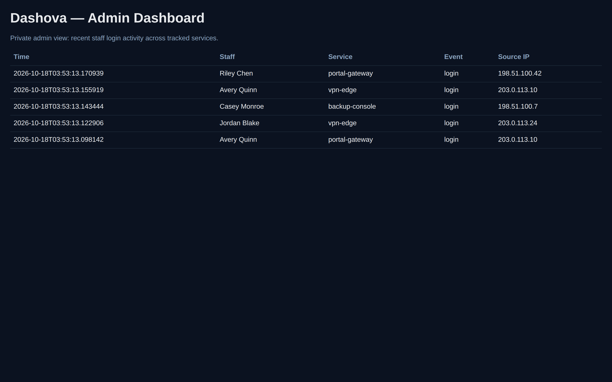

<div align="center">


# dashova

**Self-hosted IT ops dashboard for MSPs — auth-event observability, service inventory, and a lightweight admin view over Docker Compose.**

Formerly **MSPDash**.

[](https://github.com/OneByJorah/dashova/releases)
[](https://www.docker.com/)
[](https://www.python.org/downloads/)
[](https://opensource.org/licenses/MIT)

</div>



## What This Is

dashova is a small, self-hosted stack with three services:

- **dashboard** — a static admin page (nginx) showing recent staff login events
- **api** — a FastAPI service that ingests and stores auth events
- **timescaledb** — PostgreSQL 16 + TimescaleDB for event storage

Everything runs locally via Docker Compose. No cloud dependencies.

## Quick Start

```bash
git clone https://github.com/OneByJorah/dashova.git
cd dashova
cp .env.example .env
docker compose up -d --build
```

Seed a few demo events (documentation-range IPs, fake names):

```bash
curl -s -X POST http://127.0.0.1:42000/ingest/service-login \
  -H 'Content-Type: application/json' \
  -d '{"staff_email":"Avery Quinn","service_name":"portal-gateway","source_ip":"203.0.113.10"}'
```

Then open:

- **Dashboard:** `http://127.0.0.1:3000`
- **API health:** `http://127.0.0.1:42000/health`

Stop and remove everything (including the database volume):

```bash
docker compose down -v
```

## API

The API exposes exactly three endpoints:

| Endpoint | Method | Purpose |
| --- | --- | --- |
| `/health` | GET | Health probe — returns `{"status":"ok"}` |
| `/ingest/service-login` | POST | Record a staff login event (`staff_email`, `service_name`, optional `source_ip`, `user_agent`, `metadata`) |
| `/admin/events` | GET | List recent events (`?service=`, `?limit=`) |

## Features

- **Auth-event ingestion** — POST login events from any tooling you run
- **Service inventory** — services are created automatically on first sighting
- **Admin dashboard** — dark, single-page view of recent activity
- **Docker Compose** — one command brings up the full stack
- **CORS-scoped API** — the API only accepts browser origins you list in `ALLOWED_ORIGINS`

## Windows

`install.ps1` is a PowerShell-only installer for Docker Desktop hosts:

```powershell
.\install.ps1
```

It creates `.env` from `.env.example` and runs `docker compose up --build -d`. On Linux/macOS use `install.sh` or the Quick Start above.

## Screenshots

Captured against the live local stack with demo data (`scripts/screenshots.mjs`).

| Admin dashboard |
| --- |
|  |

## Project Layout

```text
api/          FastAPI service (app.py, Dockerfile, requirements.txt)
admin/        Static dashboard page served by nginx
adapters/     Reference adapters (email, osticket, password-reset)
scripts/      screenshots.mjs — Playwright capture with scrub checks
tests/        pytest suite for the API
```

## Limitations (read this)

- **Demo-mode defaults.** `.env.example` ships with `change-me` credentials for local use. Change every one of them before exposing anything to a network.
- **No authentication on the dashboard.** The admin page and `/admin/events` are unauthenticated. Keep the ports bound to localhost or put a reverse proxy with auth in front.
- **Telegram variables are placeholders.** `TELEGRAM_BOT_TOKEN` / `TELEGRAM_ADMIN_CHAT_ID` exist in `.env.example` but no code reads them yet.
- **No PyPI package.** Install via Docker; `pip install dashova` does not exist.
- **Local image tag only.** `docker compose up --build` builds and tags `ghcr.io/onebyjorah/dashova:latest` locally. It is not pulled from a registry.
- **Single-node by design.** No clustering, no HA, no multi-tenant isolation beyond the `service` field on events.

## Development

```bash
# run the API tests (SQLite fallback works without Postgres)
pip install -r api/requirements.txt pytest pytest-asyncio httpx
pytest tests/ -v

# lint markdown / Dockerfile / secrets (what CI runs)
markdownlint-cli2 "**/*.md"
hadolint Dockerfile api/Dockerfile
```

Re-capture screenshots with the stack running:

```bash
npm install --no-save playwright && npx playwright install --with-deps chromium
BASE_URL=http://127.0.0.1:3000 node scripts/screenshots.mjs
```

## Contributing

Contributions are welcome. [Open an issue](https://github.com/OneByJorah/dashova/issues) to report a bug or request a feature.

## License

MIT — see [LICENSE](LICENSE).
